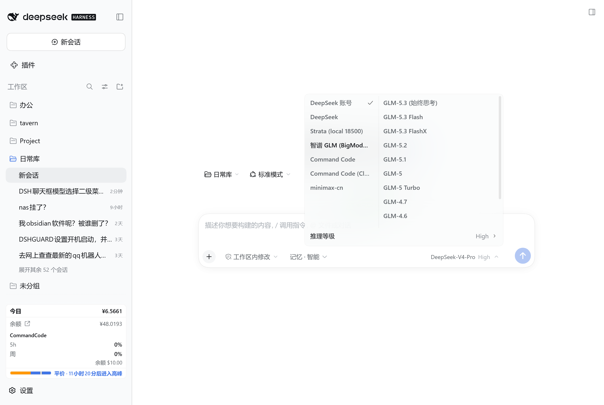

# dsh-model-menu-masterdetail

DeepSeek Harness (dsh) 客户端插件：把聊天输入框的「模型选择」座位替换成**主从双栏菜单**。



- 左栏：提供商列表（DeepSeek 账号 / Strata / 智谱 GLM / Command Code / minimax-cn …）
- 右栏：鼠标悬浮左侧某提供商时，右侧立刻显示它的全部模型（不用点击）
- 固定尺寸 412×280（约 10 行），两栏各自独立滚轮滚动，长模型名自动折行
- 一次点击直达：点 composer 的模型按钮 → 直接弹出两栏菜单
- 「推理等级」保留为菜单底部一行页脚，点它进入推理等级二级列表

## 安装（web / headless profile）

```sh
# 1) 克隆到任意目录（或 dsh 插件目录）
git clone https://github.com/whoyummy93/dsh-model-menu-masterdetail.git "$env:USERPROFILE\.dsh\plugins\dsh-model-menu-masterdetail"

# 2) 在 profile 里挂上依赖（web profile 示例）
dsh plugin --profile web add "link:C:/Users/whoyummy/.dsh/plugins/dsh-model-menu-masterdetail"

# 3) 重启 dsh web 生效
```

桌面（Electron）客户端：在 desktop profile 的 `package.json` 里加同样的 `link:` 依赖即可，代码同一份（desktop 0.2.0-rc.2 的 primitives 全部兼容）。

## 卸载

```sh
dsh plugin --profile web remove dsh-model-menu-masterdetail
```

builtin 座位不受影响（本插件只是以 priority -1 影子注册同名 slot，移除即还原）。

## 原理（写给想写类似插件的）

- 客户端模块通过 `window.__ModuleLoader__.load({id, factory})` 注册，`package.json` 里 `dsh.client` 声明要注入的 dsh 内部包。
- 用 `slots.inject("conversation.input.model", ...)` + `slots.register({priority: -1}, ModelSelect)` 影子掉内置模型座位。
- **最大的坑：cordis 注入作用域**。座位 face 里会调用 `modelDirectories.directoryFor(sessionId)`，而该服务内部要读 `this.ctx.remote.session`，服务方法按**调用方 ctx** 绑定，所以 `remote`、`remote.session` 必须一起写进 `ctx.inject([...])`；漏了就抛 `cannot get property "remote.session" without inject`，整个座位塌掉、按钮直接消失。
- 第二个坑：`.twocol` 上不能同时挂会设 `flex-direction: column` 的基础类，否则两栏变纵向堆叠；也别用 `flex: 0 0 412px`（菜单是列向 flex，basis 会作用到高度上）。

## 文件

| 文件 | 作用 |
|---|---|
| `client.js` | 全部客户端代码（React + primitives，无构建步骤） |
| `index.js` | host 半边 no-op |
| `cordis.patch.yml` | bundle patch，注册插件 id |

MIT License
